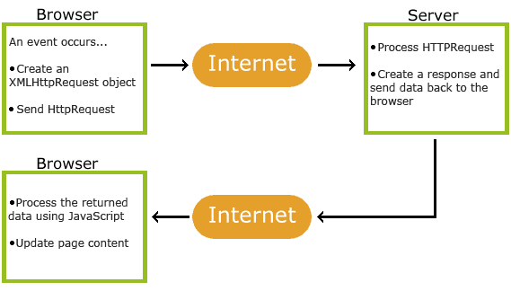
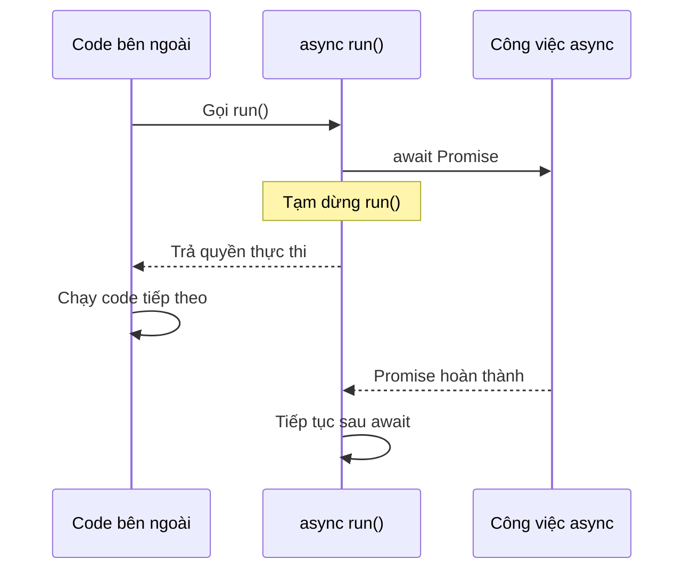
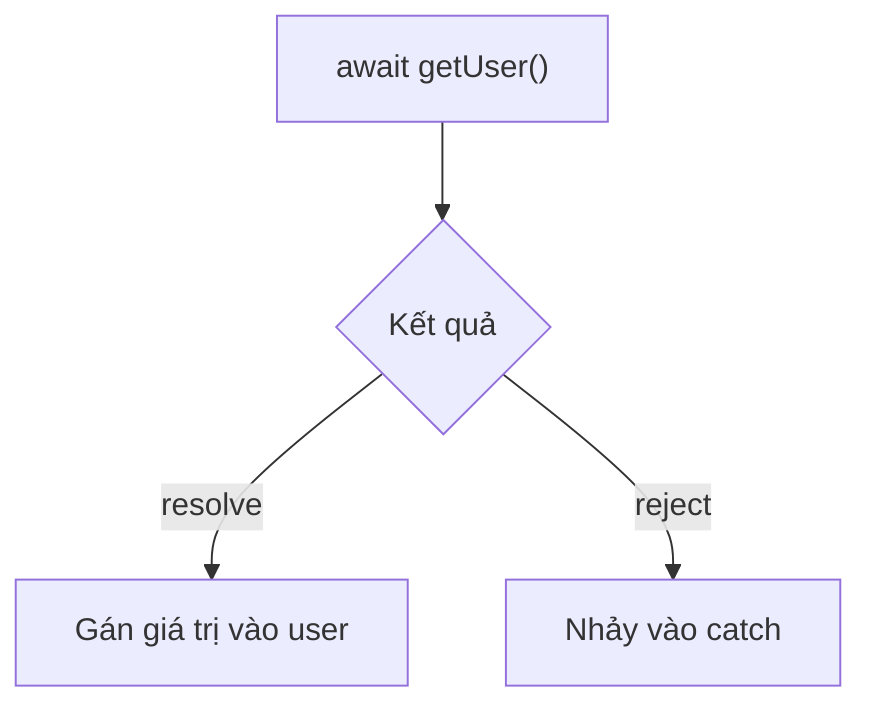

## jQuery Syntax

The jQuery syntax is tailor-made for selecting HTML elements and performing some action on the element(s).

Basic syntax is: $(selector).action()

A $ sign to define/access jQuery
A (selector) to "query (or find)" HTML elements
A jQuery action() to be performed on the element(s)

Examples:

```
$(this).hide() - hides the current element.
$("p").hide() - hides all <p> elements.
$(".test").hide() - hides all elements with class="test".
$("#test").hide() - hides the element with id="test".
```

## jQuery Selectors

jQuery selectors allow you to select and manipulate HTML element(s).

## The element Selector

The jQuery element selector selects elements based on the element name.

You can select all <p> elements on a page like this:

```
$("p")
```

When a user clicks on a button, all <p> elements will be hidden:

Example

```
$(document).ready(function(){
  $("button").click(function(){
    $("p").hide();
  });
});
```

## The #id Selector

The jQuery #id selector uses the id attribute of an HTML tag to find the specific element.

An id should be unique within a page, so you should use the #id selector when you want to find a single, unique element.

To find an element with a specific id, write a hash character, followed by the id of the HTML element:

```
$("#test")
```

When a user clicks on a button, the element with id="test" will be hidden:

Example

```
$(document).ready(function(){
  $("button").click(function(){
    $("#test").hide();
  });
});
```

## The .class Selector

The jQuery .class selector finds elements with a specific class.

To find elements with a specific class, write a period character, followed by the name of the class:

```
$(".test")
```

When a user clicks on a button, the elements with class="test" will be hidden:

Example

```
$(document).ready(function(){
  $("button").click(function(){
    $(".test").hide();
  });
});
```

## jQuery Event Methods

What are Events?
All the different visitors' actions that a web page can respond to are called events.

An event represents the precise moment when something happens.

Examples:
moving a mouse over an element
selecting a radio button
clicking on an element
The term "fires/fired" is often used with events. Example: "The keypress event is fired, the moment you press a key".

## jQuery Syntax For Event Methods

In jQuery, most DOM events have an equivalent jQuery method.

To assign a click event to all paragraphs on a page, you can do this:

```
$("p").click();
```

The next step is to define what should happen when the event fires. You must pass a function to the event:

```
$("p").click(function(){
  // action goes here!!
});
```

## AJAX basic

AJAX is a developer's dream, because you can:

Update a web page without reloading the page
Request data from a server - after the page has loaded
Receive data from a server - after the page has loaded
Send data to a server - in the background

AJAX = Asynchronous JavaScript And XML.

AJAX is not a programming language.

AJAX just uses a combination of:

A browser built-in XMLHttpRequest object (to request data from a web server)
JavaScript and HTML DOM (to display or use the data)



1. An event occurs in a web page (the page is loaded, a button is clicked)
2. An XMLHttpRequest object is created by JavaScript
3. The XMLHttpRequest object sends a request to a web server
4. The server processes the request
5. The server sends a response back to the web page
6. The response is read by JavaScript
7. Proper action (like page update) is performed by JavaScript`

Example

```
<!DOCTYPE html>
<html>
<head>
<script src="https://ajax.googleapis.com/ajax/libs/jquery/3.7.1/jquery.min.js"></script>
<script>
$(document).ready(function(){
  $("button").click(function(){
    $.ajax({url: "demo_test.txt", success: function(result){
      $("#div1").html(result);
    }});
  });
});
</script>
</head>
<body>

<div id="div1"><h2>Let jQuery AJAX Change This Text</h2></div>

<button>Get External Content</button>

</body>
</html>
```

Syntax

```
$.ajax({name:value, name:value, ... })
```

The parameters specifies one or more name/value pairs for the AJAX request.

## prop() Method

Definition and Usage
The prop() method sets or returns properties and values of the selected elements.

When this method is used to return the property value, it returns the value of the FIRST matched element.

When this method is used to set property values, it sets one or more property/value pairs for the set of matched elements.

Note: The prop() method should be used to retrieve property values, e.g. DOM properties (like tagName, nodeName, defaultChecked) or your own custom made properties.

Tip: To retrieve HTML attributes, use the attr() method instead.

Tip: To remove a property use the removeProp() method.

Syntax

```
Return the value of a property:

$(selector).prop(property)
Set the property and value:

$(selector).prop(property,value)
Set property and value using a function:

$(selector).prop(property,function(index,currentvalue))
Set multiple properties and values:

$(selector).prop({property:value, property:value,...})
```

Parameter Description
property Specifies the name of the property
value Specifies the value of the property
function(index,currentvalue) Specifies a function that returns the property value to set
index - Receives the index position of the element in the set
currentvalue - Receives the current property value of selected elements

## .filter()

Phương thức `filter()` tạo ra một mảng mới chứa các phần tử thỏa mãn điều kiện được cung cấp bởi một hàm.

Phương thức `filter()` không thực thi hàm đối với các phần tử rỗng.

Phương thức `filter()` không thay đổi mảng gốc.

```
const ages = [32, 33, 16, 40];
const result = ages.filter(checkAdult);

function checkAdult(age) {
  return age >= 18;
}
```

## .map()

Phương thức `map()` tạo một mảng mới bằng cách gọi một hàm cho mỗi phần tử của mảng.

`map()` không thực thi hàm đối với các phần tử rỗng.

`map()` không thay đổi mảng gốc.

```
const persons = [
  {firstname : "Malcom", lastname: "Reynolds"},
  {firstname : "Kaylee", lastname: "Frye"},
  {firstname : "Jayne", lastname: "Cobb"}
];

persons.map(getFullName);

function getFullName(item) {
  return [item.firstname,item.lastname].join(" ");
}
```

## .join()

Phương thức `join()` trả về một mảng dưới dạng chuỗi.

Phương thức `join()` không làm thay đổi mảng gốc.

Có thể chỉ định bất kỳ dấu phân cách nào. Mặc định là dấu phẩy (,).

```
const fruits = ["Banana", "Orange", "Apple", "Mango"];
let text = fruits.join(" and ");
```

## .on()

Phương thức on() gắn một hoặc nhiều trình xử lý sự kiện cho các phần tử được chọn và các phần tử con của chúng.

Lưu ý: Các trình xử lý sự kiện được gắn bằng phương thức on() sẽ hoạt động cho cả các phần tử hiện tại và TƯƠNG LAI (như một phần tử mới được tạo bởi một tập lệnh).

Mẹo: Để xóa các trình xử lý sự kiện, hãy sử dụng phương thức off().

Mẹo: Để gắn một sự kiện chỉ chạy một lần rồi tự xóa, hãy sử dụng phương thức one().

## .this

this trong event handler jQuery

Với hàm thông thường function () { ... }, giá trị this phụ thuộc vào cách hàm được gọi. Trong event handler, jQuery thiết lập this cho bạn.

Đoạn trong file:

```
$tableBody.on("click", ".edit-book-button", function () {
const bookId = Number(
$(this).closest("tr").data("book-id")
);

    openEditModal(bookId);

});
```

Ở đây, this là nút .edit-book-button được jQuery chọn để xử lý sự kiện.
Giả sử HTML là:

```
<tbody id="bookTableBody">
    <tr data-book-id="42">
        <td>
            <button class="edit-book-button">
                <span>Sửa</span>
            </button>
        </td>
    </tr>
</tbody>
```

## Nullish coalescing ??

The ?? operator returns the right operand when the left operand is nullish (null or undefined), otherwise it returns the left operand.

```
<script>
let name = null;
let text = "missing";
let result = name ?? text;

document.getElementById("demo").innerHTML = "The name is " + result; //The name is missing
</script>
```

## Optional chaining ?.

The Optional Chaining ( ?. ) Operator returns undefined if an object is undefined or null.

(Instead of throwing an error).

```
<script>
// Create an object:
const car = {type:"Fiat", model:"500", color:"white"};
// Ask for car name:
document.getElementById("demo").innerHTML = car?.name; //undefined
</script>
```

## .val()

`Trong dự án, cái này được sử dụng để làm Getter/Setter`

The val() method returns or sets the value attribute of the selected elements.

When used to return value:
This method returns the value of the value attribute of the FIRST matched element.

Return the value attribute:

```
$(selector).val()
```

When used to set value:
This method sets the value of the value attribute for ALL matched elements.

Note: The val() method is mostly used with HTML form elements.

```
Set the value attribute:

$(selector).val(value)
Set the value attribute using a function:

$(selector).val(function(index,currentvalue))
```

## E4 — Event bubbling và event delegation

Giả sử bảng sách có HTML:

```html
<tbody id="bookTableBody">
  <tr data-book-id="42">
    <td>
      <button class="edit-book-button">
        <span>Sửa</span>
      </button>
    </td>
  </tr>
</tbody>
```

Khi bạn click vào chữ “Sửa”, sự kiện `click` bắt đầu ở `<span>` rồi **lan lên các phần tử cha**:

```text
span → button → td → tr → tbody → ... → document
```

Đây là **event bubbling — sự kiện nổi bọt**. Nhờ vậy, handler gắn trên `tbody` cũng có thể nhận được click xuất phát từ nút bên trong.

**Event delegation — ủy quyền xử lý sự kiện** tận dụng cơ chế đó. Trong file:

```js
$tableBody.on("click", ".edit-book-button", function () {
  const bookId = Number($(this).closest("tr").data("book-id"));

  openEditModal(bookId);
});
```

Đọc câu này thành:

> “Theo dõi click tại `$tableBody`. Khi click đến từ nút khớp `.edit-book-button` bên trong, chạy handler.”

Ba đối số của `.on()`:

| Thành phần            | Ý nghĩa                                 |
| --------------------- | --------------------------------------- |
| `"click"`             | Sự kiện cần theo dõi                    |
| `".edit-book-button"` | Selector xác định phần tử con cần xử lý |
| `function () { ... }` | Handler thực hiện công việc             |

Trong handler này, `this` là nút sửa khớp selector. Code tìm hàng chứa nút, lấy ID sách rồi mở form sửa.

**Vì sao dự án dùng cách này?**

Bảng được tạo lại bằng:

```js
$tableBody.html(rowsHtml);
```

Các nút sửa cũ bị thay bằng các nút mới. Nếu đăng ký trực tiếp:

```js
$(".edit-book-button").on("click", handler);
```

Handler chỉ được gắn vào những nút tìm thấy **tại thời điểm đăng ký**. Các nút tạo sau không tự nhận handler đó.

Với delegation:

```js
$tableBody.on("click", ".edit-book-button", handler);
```

Handler nằm trên `$tableBody`, nên vẫn xử lý được các nút mới bên trong, miễn là phần tử `$tableBody` đó còn tồn tại.

Lưu ý nối với E3: `event.preventDefault()` ngăn hành vi mặc định, **không ngăn sự kiện nổi bọt**. Việc dừng nổi bọt là vai trò của `event.stopPropagation()`.

---

## E5 — Focus và thao tác bàn phím

**Focus là phần tử hiện đang nhận tương tác bàn phím.**

Ví dụ:

- Ô input có focus → gõ chữ vào ô đó.
- Nút có focus → có thể kích hoạt bằng bàn phím.
- Nhấn `Tab` → thường chuyển focus sang phần tử tương tác tiếp theo.

Trong file, focus được quản lý theo một vòng: **ghi nhớ vị trí cũ → chuyển vào modal → trả lại khi đóng**.

**Bước 1: Ghi nhớ phần tử đang có focus**

```js
lastFocusedElement = document.activeElement;
```

`document.activeElement` trả về phần tử DOM đang có focus. Code giữ tham chiếu đến phần tử này để dùng khi đóng modal.

**Bước 2: Mở modal rồi đưa focus vào ô tiêu đề**

```js
$modal.removeClass("is-hidden");

setTimeout(function () {
  $("#bookTitle").trigger("focus");
}, 0);
```

`.trigger("focus")` yêu cầu đưa focus vào ô nhập. Người dùng có thể bắt đầu gõ mà không cần click thêm.

`setTimeout(..., 0)` trì hoãn callback sang một lượt xử lý sau, sau khi đoạn JavaScript hiện tại hoàn tất. Nó không có nghĩa là chạy ngay, cũng không bảo đảm một animation đã hoàn thành.

**Bước 3: Khi đóng, trả focus về phần tử trước đó**

```js
if (lastFocusedElement) {
  $(lastFocusedElement).trigger("focus");
}
```

Việc này giúp người dùng bàn phím tiếp tục ở vị trí phù hợp sau khi rời modal.

File còn dùng focus trong validation:

```js
$form.find(".form-control--error").first().trigger("focus");
```

Đọc thành:

> “Tìm các ô lỗi trong form, lấy ô đầu tiên, đưa focus vào đó để người dùng sửa.”

Và trong hộp thoại xóa:

```js
$("#cancelDeleteButton").trigger("focus");
```

Code chủ động đặt focus vào nút hủy sau khi mở hộp thoại.

**Phân biệt focus với hiển thị:** một modal hiện ra chưa có nghĩa ô nhập đã được focus. Ngược lại, `aria-hidden` cũng không tự chuyển focus.

Ngoài ra, chuyển focus vào modal và trả lại khi đóng chưa phải **focus trap** — cơ chế giữ việc nhấn `Tab` bên trong modal. Đoạn modal tự tạo trong file chưa thể hiện cơ chế này.

---

## E6 — Vòng đời của `<dialog>`

File có hai thành phần cần phân biệt:

| Thành phần                    | Cách điều khiển trong file          |
| ----------------------------- | ----------------------------------- |
| Form thêm/sửa `#bookModal`    | Thêm/bỏ class `is-hidden`           |
| Hộp thoại xóa `#deleteDialog` | API DOM: `.showModal()`, `.close()` |

Với hộp thoại xóa, file dùng:

```js
$("#deleteDialog")[0].showModal();
```

Tách ra:

```js
const $dialog = $("#deleteDialog"); // jQuery object
const dialog = $dialog[0]; // Phần tử DOM <dialog>

dialog.showModal(); // Mở bằng API trình duyệt
```

`showModal()` mở dialog ở chế độ modal: nội dung phía ngoài dialog bị chặn tương tác thông thường.

**Vòng đời xóa trong file**

```text
Bấm Xóa ở một hàng
    ↓
Ghi nhớ ID sách vào pendingDeleteId
    ↓
showModal()
    ↓
Người dùng hủy hoặc xác nhận xóa
    ↓
close()
    ↓
Sự kiện close → xóa pendingDeleteId
```

Có hai sự kiện dễ nhầm: **`cancel` và `close`**.

**`cancel`: người dùng yêu cầu hủy dialog, thường bằng Escape**

```js
$("#deleteDialog").on("cancel", function (event) {
  if (isDeleting) {
    event.preventDefault();
  }
});
```

- Nếu đang xóa: ngăn hành vi đóng mặc định của yêu cầu hủy.
- Nếu chưa xóa: cho phép trình duyệt đóng dialog.

`cancel` có thể bị ngăn bằng `preventDefault()`.

**`close`: dialog đã đóng**

```js
$("#deleteDialog").on("close", function () {
  pendingDeleteId = null;
});
```

Đây là lúc dọn trạng thái: dialog đã đóng nên không còn ID đang chờ xác nhận xóa.

**Nút “Hủy” có tự tạo sự kiện `cancel` không?**

Trong code này, nút hủy được xử lý bằng `click`:

```js
$("#cancelDeleteButton").on("click", function () {
  if (!isDeleting) {
    $("#deleteDialog")[0].close();
  }
});
```

Nút gọi thẳng `.close()`, vì vậy luồng là:

```text
click nút Hủy → close() → sự kiện close
```

Tên nút “Hủy” không khiến nó tự phát sinh sự kiện `cancel`.

So sánh các trường hợp trong file:

| Hành động                | Kết quả                                |
| ------------------------ | -------------------------------------- |
| Nhấn Escape khi chưa xóa | `cancel` → đóng mặc định → `close`     |
| Nhấn Escape khi đang xóa | `cancel` → `preventDefault()` → vẫn mở |
| Bấm nút Hủy khi chưa xóa | Gọi `.close()` → `close`               |
| Xóa API thành công       | Gọi `.close()` → `close`               |
| Xóa API thất bại         | Giữ dialog mở và hiện lỗi              |

Điểm giúp phân biệt là: **E4 quyết định handler nhận sự kiện từ đâu; E5 quyết định bàn phím đang tương tác với phần tử nào; E6 quyết định dialog đang mở, bị yêu cầu hủy hay đã đóng.**

`async/await` không phải một cơ chế hoàn toàn khác Promise. Nó chỉ là **cú pháp giúp viết và đọc Promise dễ hơn**, khiến code bất đồng bộ nhìn gần giống code chạy tuần tự. Đây cũng là ý chính của [bài W3Schools bạn gửi](https://www.w3schools.com/js/js_async_await.asp).

Chuỗi kiến thức của chúng ta hiện tại là:

```text
Callback
    ↓
Promise tổ chức callback bằng then/catch
    ↓
async/await giúp sử dụng Promise dễ đọc hơn
```

# 1. `async` là gì?

Khi đặt từ khóa `async` trước một function:

```javascript
async function hello() {
  return "Hello";
}
```

thì function đó **luôn trả về Promise**.

Mặc dù bên trong ta return một chuỗi:

```javascript
return "Hello";
```

JavaScript tự động biến nó thành:

```javascript
return Promise.resolve("Hello");
```

Do đó:

```javascript
const result = hello();

console.log(result);
```

không in trực tiếp `"Hello"`, mà nhận được một Promise:

```text
Promise { <fulfilled>: "Hello" }
```

Muốn lấy giá trị, ta dùng:

```javascript
hello().then((value) => {
  console.log(value);
});
```

Kết quả:

```text
Hello
```

## Quy tắc quan trọng nhất của `async`

> Một `async function` luôn trả về Promise, dù bạn return giá trị bình thường hay không return gì.

| Code bên trong `async` | Kết quả thực tế                    |
| ---------------------- | ---------------------------------- |
| `return 10`            | Promise fulfilled với giá trị `10` |
| `return "Hello"`       | Promise fulfilled với `"Hello"`    |
| Không `return`         | Promise fulfilled với `undefined`  |
| `throw new Error()`    | Promise rejected với lỗi           |
| Return một Promise     | Trả kết quả của Promise đó         |

---

# 2. `async` không có nghĩa là mọi dòng trong hàm đều chạy bất đồng bộ

Xem ví dụ:

```javascript
async function test() {
  console.log("A");
  console.log("B");

  return "C";
}

test();
console.log("D");
```

Kết quả:

```text
A
B
D
```

Hai dòng `A` và `B` vẫn chạy ngay và theo thứ tự bình thường.

`async` chủ yếu làm hai việc:

1. Làm function luôn trả về Promise.
2. Cho phép sử dụng `await` bên trong function đó.

Nó không tự động biến mọi câu lệnh thành tác vụ chạy nền.

---

# 3. `await` là gì?

`await` được sử dụng để chờ một Promise hoàn thành:

```javascript
const result = await somePromise;
```

Có thể đọc là:

> “Hãy tạm dừng function này tại đây. Khi `somePromise` có kết quả thì lấy kết quả đó gán vào `result`, rồi chạy tiếp.”

Ví dụ:

```javascript
function getUser() {
  return new Promise((resolve) => {
    setTimeout(() => {
      resolve({
        id: 1,
        name: "Dương",
      });
    }, 2000);
  });
}

async function displayUser() {
  const user = await getUser();

  console.log(user);
}

displayUser();
```

Khi đến đây:

```javascript
const user = await getUser();
```

`getUser()` trả về Promise ở trạng thái `pending`.

Function `displayUser()` tạm dừng. Khoảng hai giây sau:

```javascript
resolve({
  id: 1,
  name: "Dương",
});
```

Promise thành công, giá trị được lấy ra và gán vào `user`:

```javascript
const user = {
  id: 1,
  name: "Dương",
};
```

Sau đó dòng tiếp theo mới chạy:

```javascript
console.log(user);
```

---

# 4. Tại sao `await` phải nằm trong `async`?

Thông thường, bạn phải viết:

```javascript
async function displayUser() {
  const user = await getUser();
}
```

Không thể tùy tiện viết `await` trong một function thông thường:

```javascript
function displayUser() {
  const user = await getUser(); // SyntaxError
}
```

Bởi vì `await` có thể làm function tạm dừng, nên JavaScript cần biết function đó sẽ hoạt động theo quy tắc Promise.

Ngoại lệ: `await` có thể được dùng ở cấp cao nhất của một JavaScript module, thường gọi là **top-level await**.

Nhưng trước mắt bạn cứ nhớ công thức:

```javascript
async function functionName() {
  const result = await promise;
}
```

---

# 5. `await` không chặn toàn bộ JavaScript

Đây là điểm quan trọng nhất và cũng dễ hiểu nhầm nhất.

Xem đoạn code:

```javascript
function waitTwoSeconds() {
  return new Promise((resolve) => {
    setTimeout(() => {
      resolve("Đã xong");
    }, 2000);
  });
}

async function run() {
  console.log("2. Bắt đầu chờ");

  const result = await waitTwoSeconds();

  console.log("4.", result);
}

console.log("1. Bắt đầu chương trình");

run();

console.log("3. JavaScript tiếp tục");
```

Kết quả:

```text
1. Bắt đầu chương trình
2. Bắt đầu chờ
3. JavaScript tiếp tục
4. Đã xong
```

Tại dòng:

```javascript
const result = await waitTwoSeconds();
```

chỉ có function `run()` bị tạm dừng.

Những phần JavaScript khác vẫn chạy, nên:

```javascript
console.log("3. JavaScript tiếp tục");
```

được thực hiện trước.

Có thể hình dung:



Câu ghi nhớ chuẩn xác:

> `await` tạm dừng function `async` hiện tại, không tạm dừng toàn bộ JavaScript.

---

# 6. `async/await` và `.then()` là cùng một cơ chế

Hai đoạn code sau về cơ bản làm cùng một việc.

## Dùng Promise `.then()`

```javascript
function displayUser() {
  getUser()
    .then((user) => {
      console.log(user);
    })
    .catch((error) => {
      console.log(error);
    });
}
```

## Dùng `async/await`

```javascript
async function displayUser() {
  try {
    const user = await getUser();

    console.log(user);
  } catch (error) {
    console.log(error);
  }
}
```

`await` có thể hiểu gần đúng là đang lấy giá trị từ `.then()`.

```javascript
getUser().then((user) => {
  console.log(user);
});
```

tương ứng với:

```javascript
const user = await getUser();
console.log(user);
```

Và `.catch()` tương ứng với `try...catch`:

```javascript
getUser().catch((error) => {
  console.log(error);
});
```

tương ứng với:

```javascript
try {
  const user = await getUser();
} catch (error) {
  console.log(error);
}
```

`async/await` không loại bỏ Promise. Nó chỉ giúp bạn sử dụng Promise theo cách dễ đọc hơn.

---

# 7. Phân tích ví dụ `fetch()` của W3Schools

Ví dụ trong bài:

```javascript
async function getData() {
  const response = await fetch("fetch.txt");
  const text = await response.text();

  myDisplayer(text);
}

getData();
```

## Bước 1: Gọi `getData()`

```javascript
getData();
```

Vì đây là `async function`, nó trả về Promise.

## Bước 2: Gửi request

```javascript
const response = await fetch("fetch.txt");
```

`fetch()` không trả dữ liệu hoàn chỉnh ngay. Nó trả:

```text
Promise<Response>
```

`await` chờ Promise đó thành công, rồi lấy `Response` ra:

```javascript
const response = Response;
```

## Bước 3: Đọc nội dung response

```javascript
const text = await response.text();
```

`response.text()` cũng trả về Promise:

```text
Promise<string>
```

Vì vậy ta tiếp tục `await` để chờ đọc body xong.

## Bước 4: Hiển thị kết quả

```javascript
myDisplayer(text);
```

Dòng này chỉ chạy sau khi hai công việc trên hoàn thành.

Luồng xử lý là:

```text
fetch file
    ↓
nhận Response
    ↓
đọc body thành text
    ↓
hiển thị text
```

Code nhìn tuần tự, nhưng trong thời gian chờ request, JavaScript vẫn có thể xử lý sự kiện, timer và những công việc khác.

---

# 8. Xử lý lỗi với `try...catch`

Giả sử Promise thất bại:

```javascript
function getUser() {
  return new Promise((resolve, reject) => {
    setTimeout(() => {
      reject(new Error("Không thể tải user"));
    }, 1000);
  });
}
```

Nếu chỉ viết:

```javascript
async function displayUser() {
  const user = await getUser();

  console.log(user);
}
```

khi Promise bị reject, lỗi sẽ thoát ra khỏi `displayUser()`.

Ta xử lý bằng `try...catch`:

```javascript
async function displayUser() {
  try {
    const user = await getUser();

    console.log(user);
  } catch (error) {
    console.log("Có lỗi:", error.message);
  }
}
```

Có thể hiểu:

- Promise `resolve` → `await` trả lại giá trị.
- Promise `reject` → `await` ném ra lỗi.
- `catch` bắt lỗi đó.



---

# 9. `finally` vẫn sử dụng được

Với `async/await`, ta có thể dùng `finally` của `try...catch`:

```javascript
async function loadUser() {
  showLoading();

  try {
    const user = await getUser();
    displayUser(user);
  } catch (error) {
    displayError(error.message);
  } finally {
    hideLoading();
  }
}
```

Dù thành công hay thất bại, `hideLoading()` vẫn chạy.

Đây là cách rất thường gặp trong frontend:

```javascript
try {
  setLoading(true);

  const response = await fetch("/api/users");
  const users = await response.json();

  setUsers(users);
} catch (error) {
  setError(error.message);
} finally {
  setLoading(false);
}
```

---

# 10. Lưu ý đặc biệt với `fetch()`

`fetch()` thường không tự reject chỉ vì server trả `404` hoặc `500`.

Do đó code thực tế nên kiểm tra `response.ok`:

```javascript
async function getUser() {
  const response = await fetch("/api/users/1");

  if (!response.ok) {
    throw new Error(`HTTP error: ${response.status}`);
  }

  const user = await response.json();

  return user;
}
```

Sử dụng:

```javascript
async function displayUser() {
  try {
    const user = await getUser();
    console.log(user);
  } catch (error) {
    console.log(error.message);
  }
}
```

Dòng:

```javascript
throw new Error(...)
```

làm cho Promise do `getUser()` trả về chuyển sang trạng thái rejected.

---

# 11. `return` trong `async function`

Xem ví dụ:

```javascript
async function getName() {
  return "Dương";
}
```

Mặc dù viết:

```javascript
return "Dương";
```

nhưng kết quả thật là:

```javascript
Promise.resolve("Dương");
```

Do đó cách lấy giá trị là:

```javascript
getName().then((name) => {
  console.log(name);
});
```

hoặc từ một `async function` khác:

```javascript
async function run() {
  const name = await getName();

  console.log(name);
}
```

Không được viết:

```javascript
const name = getName();

console.log(name);
```

và mong `name` là chuỗi. Lúc đó `name` là Promise.

Đây là lỗi người mới gặp rất nhiều:

```javascript
async function getUser() {
  return {
    id: 1,
    name: "Dương",
  };
}

const user = getUser();

console.log(user.name); // undefined
```

Đúng:

```javascript
async function run() {
  const user = await getUser();

  console.log(user.name);
}
```

---

# 12. Nếu `async function` ném lỗi thì sao?

```javascript
async function getUser() {
  throw new Error("Không tìm thấy user");
}
```

Nó tương đương với:

```javascript
function getUser() {
  return Promise.reject(new Error("Không tìm thấy user"));
}
```

Ta bắt lỗi bằng:

```javascript
getUser().catch((error) => {
  console.log(error.message);
});
```

hoặc:

```javascript
async function run() {
  try {
    await getUser();
  } catch (error) {
    console.log(error.message);
  }
}
```

---

# 13. `await` một giá trị không phải Promise thì sao?

JavaScript vẫn cho phép:

```javascript
async function test() {
  const result = await 10;

  console.log(result);
}
```

Kết quả cuối cùng là:

```text
10
```

JavaScript xử lý gần giống:

```javascript
const result = await Promise.resolve(10);
```

Nhưng thực tế, `await` thường được dùng với Promise:

```javascript
await fetch(...);
await response.json();
await axios.get(...);
```

Không có lý do thực tế để viết `await 10`.

---

# 14. Nhiều `await` chạy tuần tự

Xem code:

```javascript
async function getData() {
  const user = await getUser();
  const orders = await getOrders(user.id);
  const details = await getOrderDetails(orders[0].id);

  return details;
}
```

Các công việc phụ thuộc nhau, nên chạy tuần tự là đúng:

```text
Lấy user
    ↓
Dùng user.id để lấy orders
    ↓
Dùng order.id để lấy details
```

Việc sau cần kết quả việc trước.

---

# 15. Không phải lúc nào cũng nên `await` tuần tự

Giả sử cần lấy ba dữ liệu độc lập:

```javascript
async function loadPage() {
  const users = await getUsers();
  const products = await getProducts();
  const categories = await getCategories();
}
```

Nếu mỗi request mất hai giây, chúng chạy lần lượt thì tổng thời gian có thể gần sáu giây:

```text
getUsers       2 giây
getProducts    2 giây
getCategories  2 giây
Tổng cộng      6 giây
```

Nếu chúng không phụ thuộc nhau, nên chạy song song:

```javascript
async function loadPage() {
  const usersPromise = getUsers();
  const productsPromise = getProducts();
  const categoriesPromise = getCategories();

  const users = await usersPromise;
  const products = await productsPromise;
  const categories = await categoriesPromise;
}
```

Cách phổ biến và gọn hơn:

```javascript
async function loadPage() {
  const [users, products, categories] = await Promise.all([
    getUsers(),
    getProducts(),
    getCategories(),
  ]);
}
```

Lúc này cả ba bắt đầu gần như cùng lúc. Tổng thời gian có thể chỉ khoảng hai giây.

Quy tắc:

- Công việc sau phụ thuộc việc trước → `await` tuần tự.
- Các công việc độc lập → cân nhắc `Promise.all()`.

---

# 16. Một lỗi phổ biến trong `forEach`

Đoạn này trông hợp lý nhưng thường không hoạt động như mong đợi:

```javascript
users.forEach(async (user) => {
  await saveUser(user);
});

console.log("Đã lưu xong");
```

`forEach()` không chờ các Promise bên trong callback, nên `"Đã lưu xong"` có thể được in trước khi lưu hết.

Nếu muốn xử lý tuần tự:

```javascript
for (const user of users) {
  await saveUser(user);
}

console.log("Đã lưu xong");
```

Nếu muốn xử lý song song:

```javascript
await Promise.all(users.map((user) => saveUser(user)));

console.log("Đã lưu xong");
```

---

# 17. `async` với arrow function

Function thông thường:

```javascript
async function getUser() {
  const response = await fetch("/api/user");
  return response.json();
}
```

Arrow function:

```javascript
const getUser = async () => {
  const response = await fetch("/api/user");
  return response.json();
};
```

Có tham số:

```javascript
const getUserById = async (id) => {
  const response = await fetch(`/api/users/${id}`);
  return response.json();
};
```

Trong React, bạn có thể gặp:

```javascript
const handleSubmit = async () => {
  try {
    const response = await fetch("/api/users", {
      method: "POST",
      headers: {
        "Content-Type": "application/json",
      },
      body: JSON.stringify(formData),
    });

    if (!response.ok) {
      throw new Error("Không thể lưu user");
    }

    const savedUser = await response.json();
    console.log(savedUser);
  } catch (error) {
    console.log(error.message);
  }
};
```

---

# 18. Không viết trực tiếp `async` cho callback của `useEffect`

Trong React, không nên viết:

```javascript
useEffect(async () => {
  const response = await fetch("/api/users");
}, []);
```

Bởi vì callback của `useEffect` phải trả về:

- Không có gì (`undefined`), hoặc
- Cleanup function.

Nhưng `async function` luôn trả về Promise.

Nên viết:

```javascript
useEffect(() => {
  async function loadUsers() {
    try {
      const response = await fetch("/api/users");

      if (!response.ok) {
        throw new Error("Không thể tải users");
      }

      const users = await response.json();
      setUsers(users);
    } catch (error) {
      setError(error.message);
    }
  }

  loadUsers();
}, []);
```

Hoặc khai báo function bên ngoài effect rồi gọi nó.

---

# 19. Bảng so sánh ba giai đoạn

Giả sử cần lấy user rồi lấy orders.

## Callback

```javascript
getUser(1, (error, user) => {
  if (error) {
    console.log(error);
    return;
  }

  getOrders(user.id, (error, orders) => {
    if (error) {
      console.log(error);
      return;
    }

    console.log(orders);
  });
});
```

## Promise

```javascript
getUser(1)
  .then((user) => {
    return getOrders(user.id);
  })
  .then((orders) => {
    console.log(orders);
  })
  .catch((error) => {
    console.log(error);
  });
```

## `async/await`

```javascript
async function displayOrders() {
  try {
    const user = await getUser(1);
    const orders = await getOrders(user.id);

    console.log(orders);
  } catch (error) {
    console.log(error);
  }
}
```

Ba đoạn có cùng mục đích. `async/await` chỉ làm luồng xử lý dễ nhìn nhất.

---

# 20. Cách nhớ thật ngắn

## `async`

```javascript
async function getData() {
  return data;
}
```

Có nghĩa:

> Function này luôn trả về Promise.

## `await`

```javascript
const data = await getData();
```

Có nghĩa:

> Tạm dừng function `async` hiện tại, chờ Promise có kết quả rồi lấy kết quả ra.

## `try...catch`

```javascript
try {
  const data = await getData();
} catch (error) {
  console.log(error);
}
```

Có nghĩa:

> Nếu Promise bị reject thì bắt lỗi ở `catch`.

Công thức đầy đủ thường dùng:

```javascript
async function loadData() {
  try {
    const response = await fetch("/api/data");

    if (!response.ok) {
      throw new Error(`HTTP error: ${response.status}`);
    }

    const data = await response.json();

    return data;
  } catch (error) {
    console.error(error);
    throw error;
  }
}
```
