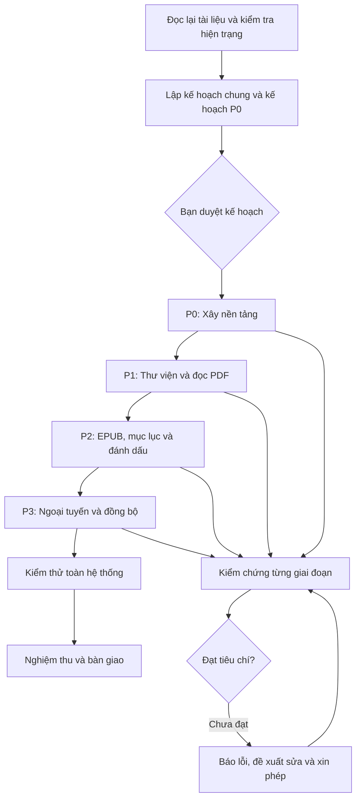

# Khung kế hoạch triển khai Book Reader

Ngày lập: 22/11/2026.

- Căn cứ: bộ tài liệu chuẩn **1.0** đã thống nhất.
- Trạng thái: khung kế hoạch để rà soát, chưa phải xác nhận triển khai hoặc nghiệm thu đạt.
- Trước khi lập kế hoạch chi tiết, cần đọc lại repository và đối chiếu tài liệu hiện hành.

## 1. Phạm vi dự án

| Nội dung | Phạm vi đã chốt |
|---|---|
| Người sử dụng | Cá nhân trước; chuẩn bị ranh giới cho tài khoản nhiều người sau |
| Thiết bị | Máy tính và điện thoại |
| Truy cập | Mạng nội bộ nhà; Internet/Cloud/AWS để giai đoạn sau |
| Định dạng | PDF thường/quét ảnh; EPUB2/3 tự dàn nội dung, không DRM |
| Chức năng | Thư viện, nhập tệp/URL, đọc, sáng/tối, mục lục, đánh dấu, nhớ vị trí |
| Ngoại tuyến | Tải sách, lưu thay đổi, đồng bộ hai chiều và xử lý xung đột |
| Công nghệ | React/TypeScript/Vite, Spring Boot/JPA, SQL Server |
| Giới hạn chính | 100 MiB/tệp; các giới hạn khác theo tài liệu đã duyệt |

**Ngoài bản đầu:** OCR, DRM, PDF có mật khẩu, EPUB bố cục cố định, chia sẻ công khai và xuất tệp sách đã sửa.

## 2. Trình tự thực hiện

## 3. Công việc và đầu ra từng giai đoạn

| Giai đoạn | Công việc chính | Điều kiện hoàn thành |
|---|---|---|
| Chuẩn bị | Đối chiếu RD/BD/rules; xác định phụ thuộc; lập kế hoạch chung và bảng nghiệm thu theo giai đoạn | Bạn duyệt kế hoạch và phạm vi thao tác |
| P0 — Nền tảng | Chuyển cấu hình mẫu sang stack đã chọn; khởi tạo backend/frontend; kết nối DB; migration; danh tính cá nhân; kiểm quyền sở hữu; khung giao diện sáng/tối | Ứng dụng khởi động, truy cập qua điểm vào dự kiến, kết nối DB và có bộ kiểm tra cơ bản |
| P1 — PDF | Nhập PDF từ tệp/URL; quản lý thư viện; xử lý sách trùng/lỗi; đọc, phóng to, chuyển trang; lưu và đặt lại tiến độ trực tuyến | Đi trọn luồng nhập → đọc → đóng/mở lại; xử lý đúng lỗi và xóa sách |
| P2 — EPUB và điều hướng | Đọc EPUB; chỉnh chữ/lề; mục lục gốc/cá nhân; đánh dấu; cập nhật dữ liệu đọc trực tuyến | Đạt phần EPUB và mục lục/đánh dấu trực tuyến trên PC/mobile |
| P3 — Ngoại tuyến | PWA; tải/xóa bản tải; hàng đợi bền vững; nhận/gửi dữ liệu; xử lý xung đột; cách ly dữ liệu chưa gửi; sao lưu/phục hồi | Đọc được khi mất mạng; nối lại không mất hoặc nhân đôi dữ liệu; đạt FR-03-06 |
| Bàn giao | Kiểm thử toàn bộ, đo chất lượng, rà bảo mật; hướng dẫn cài đặt, sử dụng và xử lý lỗi | Có bằng chứng nghiệm thu, giới hạn còn lại và hướng dẫn vận hành |

## 4. Cách làm cho mỗi phần

Mỗi đề xuất chỉnh sửa sẽ nêu:

- Tệp dự kiến thay đổi và mục đích.
- Hành vi sau thay đổi, ảnh hưởng và cách kiểm tra.
- Giải thích ngắn các khái niệm mới để bạn theo dõi được mã.

**Mọi lần chạy lệnh, sửa/xóa tệp và commit/push đều cần được bạn cho phép trước.**

Nếu cần thay đổi yêu cầu đã chốt, lập yêu cầu thay đổi trước khi thực hiện.

## 5. Kiểm thử và nghiệm thu

| Loại kiểm tra | Trọng tâm |
|---|---|
| Kiểm thử đơn vị | Quy tắc nghiệp vụ, kiểm dữ liệu, vị trí đọc và xử lý xung đột |
| Kiểm thử tích hợp | API–SQL Server–lưu tệp; migration; quyền sở hữu; chống thực hiện lặp |
| Kiểm thử luồng sử dụng | Nhập sách → đọc → lưu → mở lại; mục lục; ngoại tuyến và đồng bộ |
| Rà soát bảo mật | Tệp/EPUB độc hại, URL truy cập mạng nội bộ, quyền đọc tệp, lộ thông tin |
| Kiểm thử hồi quy | Chạy lại các luồng đã đạt sau thay đổi liên quan |
| Kiểm tra thiết bị/vận hành | PC/mobile, sáng/tối, HTTPS mạng nhà, dung lượng, sao lưu và phục hồi |

Nghiệm thu dựa trên **27 yêu cầu chức năng, 18 quy tắc nghiệp vụ, 59 tình huống nghiệm thu và các yêu cầu phi chức năng** đã chốt.

- Mỗi kết quả phải có bằng chứng.
- Phần chưa kiểm được phải ghi rõ.
- Chỉ tiêu tính theo giai đoạn; P0 không được coi là hoàn thành các tiêu chí của P1–P3.

## 6. Tài liệu liên quan

- [Tiến độ hiện tại](PROGRESS.md).
- [Sổ tài liệu chuẩn](BASELINE-REGISTER.md).
- [Chiến lược xây dựng](../plan/STRATEGY.md).
- [Danh mục yêu cầu](../plan/RD/RD-INDEX.md).
- [Danh mục thiết kế](../plan/BD/BD-INDEX.md).

Kế hoạch chi tiết từng giai đoạn sẽ được lập trong `plan/Implementation plan/` sau khi được phép ghi tệp tương ứng.
