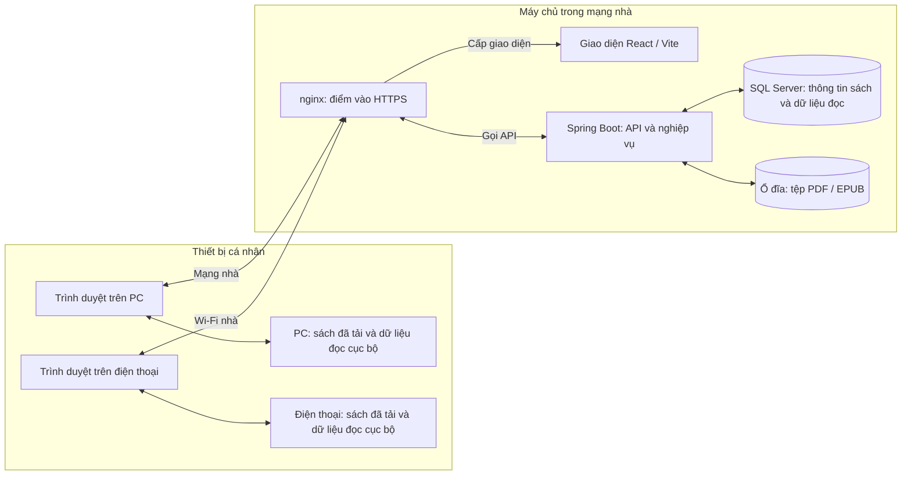
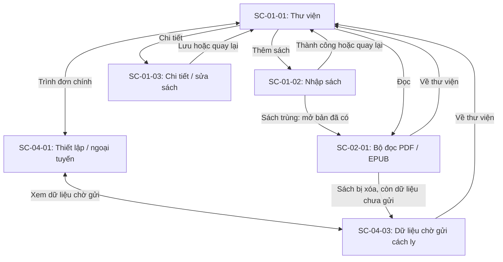
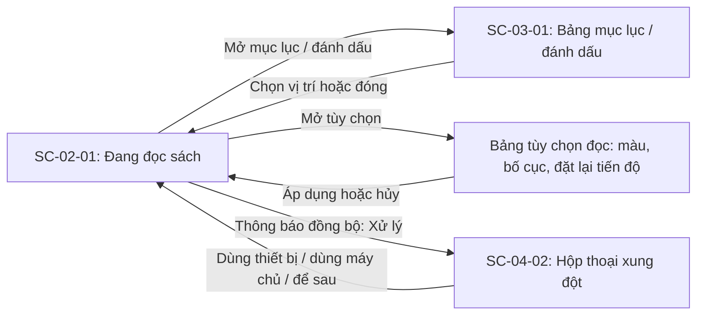

# Tổng quan hệ thống và liên kết màn hình

- **Ngày lập:** 22/11/2026.
- **Mục đích:** bản đồ đọc nhanh từ RD/BD chuẩn 1.0; không bổ sung chức năng mới.
- **Trạng thái:** sơ đồ tài liệu, chưa phải các màn hình đã lập trình.

## 1. Hệ thống chạy như thế nào?

- Giao diện được tải về và chạy trong trình duyệt; React không truy cập DB trực tiếp.
- PC và điện thoại dùng chung thư viện trên máy chủ, nhưng mỗi thiết bị có bản ngoại tuyến riêng.
- Máy chủ phải bật để nhập sách, tải sách hoặc đồng bộ.
- Ngoài mạng nhà chỉ đọc được sách đã tải đầy đủ; kết nối lại mạng nhà mới đồng bộ.
- Chưa có đăng nhập ở bản đầu. Chỉ cho thiết bị tin cậy kết nối.
- Internet/Cloud/AWS thuộc giai đoạn sau, chưa chọn dịch vụ.

## 2. Bản đồ các màn hình

**Màn hình trung tâm là Thư viện.** Đọc sách mở từ thẻ sách; nhập mới và sửa thông tin xong quay lại danh sách.

Xóa sách được xác nhận tại Thư viện/Chi tiết, không phải một màn hình riêng. Nếu còn thay đổi chưa gửi, xử lý theo quy tắc lưu riêng/đồng bộ trước/hủy.

## 3. Các bảng và hộp thoại trong bộ đọc

- Mục lục và đánh dấu là bảng trong bộ đọc, không có tuyến riêng.
- Tùy chọn đọc là điều khiển của bộ đọc; khác màn hình Thiết lập/ngoại tuyến toàn ứng dụng.
- PDF có chọn trang, phóng to và vừa chiều rộng; EPUB có cỡ chữ, giãn dòng và lề.
- Đổi tùy chọn giữ vị trí đang đọc. Đặt lại tiến độ có xác nhận riêng.
- Hộp thoại xung đột có thể so vị trí đọc, cùng một đánh dấu hoặc cả cây mục lục.
- Trên PC dùng thanh bên; trên điện thoại dùng bảng trượt/hộp thoại phù hợp màn hình.

## 4. Đường dẫn và thời điểm có chức năng

| Mã | Màn hình / thành phần | Tuyến | Giai đoạn |
|---|---|---|---|
| SC-01-01 | Thư viện | `/` | P1 |
| SC-01-02 | Nhập sách | `/books/import` | P1 PDF; P2 EPUB |
| SC-01-03 | Chi tiết / sửa | `/books/:id` | P1 |
| SC-02-01 | Bộ đọc | `/reader/:bookId` | P1 PDF; P2 EPUB |
| SC-03-01 | Mục lục / đánh dấu | Bảng trong bộ đọc | P2 trực tuyến; P3 ngoại tuyến |
| SC-04-01 | Thiết lập / ngoại tuyến | `/settings` | P3; điều khiển màu có trước |
| SC-04-02 | Xung đột đồng bộ | Hộp thoại trong bộ đọc | P3 |
| SC-04-03 | Dữ liệu chờ gửi cách ly | `/settings/pending-data` | P3 |

P0 chỉ dựng khung. Các tuyến hoặc thành phần xuất hiện sớm dưới dạng khung không đồng nghĩa chức năng đã hoàn thành.

## 5. Phân biệt ba thao tác dễ nhầm

| Thao tác | Tác động chính | Dữ liệu giữ lại |
|---|---|---|
| Xóa bản tải về | Bỏ tệp trên thiết bị hiện tại | Sách máy chủ, dữ liệu đọc và thay đổi chờ gửi |
| Xóa sách | Bỏ sách khỏi thư viện, thu hồi quyền mở sau khi thiết bị nhận biết | Dữ liệu theo thời hạn giữ; phần chưa gửi được xử lý/cách ly |
| Đặt lại tiến độ | Chuyển vị trí thành Chưa bắt đầu | Sách, tệp đã tải, mục lục và đánh dấu |

Đồng bộ không tự chọn trang lớn nhất. Khi hai phía cùng sửa, giữ bản cần thiết và cho người đọc lựa chọn.

## 6. Nguồn chi tiết

- [Danh mục màn hình chuẩn](BD-SCREEN-INDEX.md).
- [Kiến trúc và chuẩn chung](BD-00_OVERVIEW.md).
- [Hạ tầng mạng nhà](BD-05_INFRA_DEPLOYMENT.md).
- [Bộ đọc](BD-M02_reader.md).
- [Mục lục và đánh dấu](BD-M03_navigation.md).
- [Tiến độ và ngoại tuyến](BD-M04_reading-state-offline.md).
- [Khung kế hoạch toàn dự án](../../management/IMPLEMENTATION-ROADMAP.md).
- [Kế hoạch P0](<../Implementation plan/01_IMPL_PLAN_P0.md>).

Sơ đồ này minh họa thiết kế hiện hành. Nếu cần thêm màn hình hoặc thay luồng nghiệp vụ, cập nhật RD/BD theo quy trình thay đổi trước triển khai.
