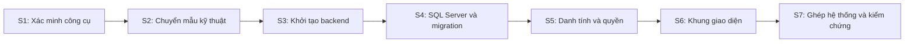

# P0 — Kế hoạch xây nền tảng

- **Ngày lập:** 22/11/2026.
- **Phiên bản:** 0.1 — kế hoạch chờ duyệt trước triển khai.
- **Căn cứ:** tài liệu chuẩn 1.0; không thay đổi yêu cầu đã chốt.
- **Phạm vi cho phép hiện tại:** đọc repository và ghi tài liệu kế hoạch; chưa cho phép cài đặt, lập trình hoặc chạy kiểm thử ứng dụng.

## 1. Mục tiêu và giới hạn

**Mục tiêu:** có khung ứng dụng khởi động được, kết nối SQL Server, xác định người đọc cá nhân, giao diện tiếng Việt sáng/tối và cách kiểm chứng thống nhất.

P0 tạo nền tảng; chưa nghiệm thu nhập sách, đọc PDF/EPUB, mục lục hoặc đồng bộ ngoại tuyến.

## 2. Hiện trạng đã kiểm tra

| Nội dung | Quan sát | Giới hạn bằng chứng |
|---|---|---|
| Ứng dụng mới | Chưa có `backend/pom.xml`, `frontend/package.json` | Chưa thể chạy bộ kiểm tra ứng dụng mới |
| Mẫu kỹ thuật | Docker, Makefile và nhiều quy tắc còn Python/Next.js/PostgreSQL | Phải chuyển trước khi sử dụng |
| Kế hoạch | Trước đợt này chỉ có mẫu kế hoạch và khung tổng thể | Tệp này là kế hoạch mới, chưa triển khai |
| Công cụ | Tìm thấy Java, Node/npm, Maven và Git trên PATH | Chưa kiểm phiên bản thực tế hoặc tương thích |
| Docker | Không tìm thấy lệnh trong lần tra PATH trước | Không kết luận chưa cài; cần kiểm lại khi được phép |
| SQL Server/HTTPS | Có thiết kế nhưng chưa có bằng chứng chạy | Cần môi trường thử riêng, tránh dữ liệu thật |

## 3. Quy trình làm việc

Mỗi bước đi theo **Đọc → Đề xuất sửa → Bạn cho phép → Viết mã → Bạn cho phép kiểm tra → Báo kết quả**.

- Trước chỉnh sửa: nêu tệp, mục đích và ảnh hưởng.
- Trước chạy lệnh: nêu nhóm lệnh, nơi chạy và dữ liệu có thể tạo.
- Không tự cài phần mềm, tạo DB, cấp chứng chỉ hoặc đổi tường lửa.
- Không sửa `Project_ngan` và `template-ai` gốc.
- Không ghi đè thay đổi của bạn; không xóa hàng loạt mã mẫu.
- Commit/push chỉ thực hiện khi bạn yêu cầu.

## 4. Các bước chi tiết

Đường dẫn mã dưới đây tính từ `source code/`; đường dẫn tài liệu tính từ thư mục `book-reader/`.

### P0-S1 — Xác minh môi trường và phiên bản

**Đọc:** `references/STACK.md`; BD-05 §1–3; sổ mốc chuẩn §3.

**Dự kiến ghi:** kết quả xác minh vào `references/STACK.md` và hồ sơ tiến độ sau khi được phép.

**Thực hiện:**

- Kiểm phiên bản Java, Node/npm, Maven, Docker và kiến trúc máy.
- Kiểm tương thích Spring Boot/JPA/JDBC/Flyway với SQL Server; đối chiếu tài liệu chính thức lúc chọn phiên bản.
- Xác định SQL Server thử nghiệm đang có hay cần tạo; thống nhất quyền truy cập và nơi lưu dữ liệu.
- Xác định công cụ tạo HTTPS nội bộ, thiết bị mobile kiểm chứng và vị trí sao lưu khác ổ gốc.

**Kiểm chứng:** lưu phiên bản, nguồn đối chiếu và kết quả; không ghi “đã tương thích” chỉ vì lệnh có trên PATH.

**Hoàn thành khi:** có bộ phiên bản và môi trường thử được xác minh; nếu cần cài đặt hoặc đổi lựa chọn đã chốt, trình phương án trước.

### P0-S2 — Chuyển bộ khung kỹ thuật

**Đọc:** AGENTS; BD-00 §2/§4/§10; BD-05 §6; các quy tắc kế thừa có liên quan.

**Dự kiến sửa:**

- `source code/CLAUDE.md`, `.claude/rules/`, `.claude/skills/`, `.claude/agents/`.
- Dockerfiles, `docker-compose.yml`, `Makefile`, `.env.example`, `infra/nginx/nginx.conf`.
- `GETTING-STARTED.md` và README của mã nguồn/backend/frontend/ops.

**Thực hiện:**

- Chuyển cấu trúc, lệnh và ví dụ sang Java/Spring Boot, React/Vite và SQL Server.
- Đánh dấu rõ phần Celery/AI không dùng; không xóa trước khi được cho phép.
- Tách chế độ phát triển với cấu hình chạy trong mạng nhà.
- Định nghĩa tên lệnh kiểm tra; chỉ chạy sau khi bước tương ứng đã có mã và được phép.

**Kiểm chứng:** rà đường dẫn, biến cấu hình, cổng và hướng dẫn; không còn chỉ dẫn chạy nhầm stack.

**Hoàn thành khi:** tài liệu và cấu hình cùng mô tả một kiến trúc; chưa coi Docker build thành công ở bước chỉ rà cấu hình.

### P0-S3 — Khởi tạo backend

**Đọc:** BD-00 §4/§6/§9/§10; BD-03 §6; BD-05 §3.

**Dự kiến tạo:**

- `backend/pom.xml`, Maven Wrapper và cấu trúc `src/main`, `src/test`.
- Điểm khởi động Spring Boot; cấu hình có kiểu và hồ sơ chạy.
- Thành phần xử lý lỗi chuẩn, mã truy vết, ghi nhật ký an toàn và kiểm sức khỏe.

**Kiểm chứng dự kiến:**

- Kiểm thử đơn vị cho cấu hình hợp lệ/không hợp lệ và nội dung lỗi không lộ bí mật.
- Khởi động tiến trình thật; kiểm API sức khỏe, đường dẫn không tồn tại và lỗi chuẩn.
- Phân biệt tiến trình còn hoạt động với sẵn sàng phục vụ; kết nối DB/lưu trữ được bổ sung ở S4/S7.

**Kiểm tra tay:** đọc nhật ký và phản hồi HTTP; không chỉ xem tiến trình hoặc container có tồn tại.

**Hoàn thành khi:** backend khởi động và báo lỗi có kiểm soát; chưa có API sách giả để tuyên bố xong P1.

### P0-S4 — SQL Server và dữ liệu nền

**Đọc:** BD-02 §1/§2/§4/§6/§7; BD-05 §2.

**Dự kiến tạo:**

- Cấu hình kết nối/JPA/Flyway.
- `backend/src/main/resources/db/migration/V001__identity_and_audit.sql`.
- Mô hình và khởi tạo người đọc cá nhân, nhật ký hoạt động theo thiết kế.
- Kiểm thử tích hợp trong `backend/src/test/`.

**Kiểm chứng dự kiến:**

- Chạy migration trên SQL Server thử nghiệm trống và có dữ liệu mẫu phù hợp.
- Chạy lại migration/khởi tạo không nhân đôi, không sửa migration đã áp dụng.
- Kiểm UUID người đọc ổn định, thời gian UTC và ràng buộc dữ liệu.
- Bật/kiểm `ALLOW_SNAPSHOT_ISOLATION` trên DB thử theo quyền được cho phép.
- Mất kết nối hoặc cấu hình sai phải báo chưa sẵn sàng; không tự tạo lại DB.

**Hoàn thành khi:** kết nối và migration có bằng chứng trên SQL Server thật. V002–V004 cho sách/tiến độ/mục lục thực hiện ở giai đoạn sở hữu chức năng đó.

### P0-S5 — Danh tính và nền tảng kiểm quyền

**Đọc:** RD-00 §3/§6; BD-03 §1/§5; BD-M05 §1.

**Dự kiến tạo:** `CurrentReader`, `ReaderContext`, `AccessPolicy` và danh mục quyền trong backend.

**Kiểm chứng dự kiến:**

- Reader cá nhân lấy từ cấu hình tin cậy, không nhận từ body/header/query.
- Quyền đúng được cho qua; quyền thiếu bị từ chối với lỗi thống nhất.
- Hai danh tính thử nghiệm không làm thay đổi danh tính sản phẩm.
- Cấu hình chế độ không hợp lệ làm dừng khởi động có giải thích.

**Hoàn thành khi:** danh tính/chính sách có kiểm thử và cách dùng thống nhất. Cách ly dữ liệu sách qua SQL/API/tệp phải kiểm tiếp ở P1; P0 chưa đủ để chứng minh toàn bộ quyền sở hữu.

### P0-S6 — Khởi tạo frontend và khung giao diện

**Đọc:** BD-00 §7/§8; BD-01; BD-SCREEN-INDEX.

**Dự kiến tạo:**

- `frontend/package.json`, lockfile, cấu hình Vite/TypeScript và React Router.
- `frontend/src/app/`, `components/`, `styles/`, `i18n/`, `test/`.
- Nhà cung cấp TanStack Query; công cụ sinh mã gọi API từ OpenAPI.
- Bộ kiểm thử thành phần và cấu hình kiểm luồng trình duyệt.

**Thực hiện:**

- Tạo khung bố cục, trình đơn, tiếng Việt và màu sáng/tối.
- Tạo thành phần dùng chung: đang tải, trống, lỗi có thử lại, không có quyền/không tìm thấy.
- Route nghiệp vụ chỉ là khung ở P0; không hiển thị sách mẫu như dữ liệu thật.
- Chuẩn bị sinh mã API theo hợp đồng backend; API nghiệp vụ thêm ở P1–P3.

**Kiểm chứng dự kiến:** kiểm kiểu, định dạng, thành phần, biên dịch; bàn phím và bố cục tại 375/768/1280px.

**Hoàn thành khi:** khung giao diện truy cập được, sáng/tối và trạng thái dùng chung hoạt động; chưa nghiệm thu bộ đọc.

### P0-S7 — Ghép hệ thống, CI và đóng giai đoạn

**Đọc:** BD-05 §1–3/§8; BD-03 §1/§6; mẫu biên bản kết thúc giai đoạn.

**Dự kiến tạo/sửa:** cấu hình nginx/Compose, kịch bản `ops/`, cấu hình CI và `management/P0-EXIT-GATE.md`.

**Lưu ý vị trí CI:** GitHub Actions cần điểm vào tại `<repository>/.github/workflows/`. Đây là vị trí ngoài `source code/`; phải trình duyệt ngoại lệ cấu trúc trước khi tạo. Kịch bản kiểm tra dùng lại vẫn đặt trong `source code/ops/`.

**Kiểm chứng dự kiến:**

- Chạy backend/frontend và SQL Server theo bộ phiên bản đã xác minh.
- Truy cập giao diện, API sức khỏe và phản hồi lỗi backend qua nginx; kiểm deep link không trả 404 của web server.
- Kiểm HTTPS nội bộ trên PC/điện thoại được phép; không mở Internet hoặc cổng SQL ra LAN.
- Mất DB phải thấy trạng thái chưa sẵn sàng từ ứng dụng thật, không bị sức khỏe nginx che lỗi.
- CI và máy phát triển dùng cùng lệnh kiểm tra; chạy lại sau thay đổi liên quan để phát hiện hồi quy.

**Hoàn thành khi:** có bằng chứng tiêu chí P0 dưới đây; phần chưa kiểm được phải ghi rõ, không tự bỏ qua để đóng giai đoạn.

## 5. Tiêu chí hoàn thành P0

Đây là tiêu chí triển khai nền tảng, không thay mã AC đã chốt của P1–P3.

| Mã | Tiêu chí | Bước | Bằng chứng dự kiến |
|---|---|---|---|
| P0-AC-01 | Phiên bản và môi trường thử được xác minh | S1 | Bảng STACK và kết quả kiểm |
| P0-AC-02 | Hướng dẫn/cấu hình không chạy nhầm stack cũ | S2 | Rà soát thay đổi và lệnh sử dụng |
| P0-AC-03 | Backend khởi động thật, lỗi chuẩn và không lộ bí mật | S3 | Kiểm thử, HTTP và nhật ký |
| P0-AC-04 | V001 chạy đúng trên SQL Server; khởi tạo lặp không nhân đôi | S4 | Kết quả migration/tích hợp |
| P0-AC-05 | Reader ổn định, không bị giả mạo qua yêu cầu | S5 | Kiểm thử chính sách/danh tính |
| P0-AC-06 | Khung UI tiếng Việt, sáng/tối, dùng được bàn phím và không tràn khung | S6 | Kiểm thử, ảnh/kích thước màn hình |
| P0-AC-07 | Giao diện/API đi qua nginx; HTTPS nội bộ và deep link hoạt động | S7 | Luồng PC/mobile và HTTP |
| P0-AC-08 | CI chạy bộ kiểm tra; lỗi DB không bị báo thành khỏe | S7 | Kết quả CI và tình huống lỗi |
| P0-AC-09 | Có biên bản kết quả, giới hạn và cách chạy lại | S7 | P0-EXIT-GATE và PROGRESS |

## 6. Phạm vi kiểm thử và giới hạn

- **Đơn vị:** cấu hình, danh tính, quyền, xử lý lỗi và thành phần giao diện.
- **Tích hợp:** Spring–JPA–SQL Server–Flyway; khởi tạo và lỗi kết nối.
- **Bảo mật:** danh tính không bị thay từ client; không lộ bí mật; chỉ lộ HTTPS ở mạng nhà theo cấu hình.
- **Hồi quy:** chạy lại kiểm tra phía bị ảnh hưởng, sau đó luồng toàn hệ thống ở bước đóng P0.
- **Chưa thuộc P0:** đọc sách, sách trùng, chống SSRF khi nhập URL, EPUB độc hại, đồng bộ và phục hồi thư viện thật. Kiểm các phần này ở P1–P3 theo RD/BD.

## 7. Nguồn tham chiếu

- [Khung kế hoạch chung](../../management/IMPLEMENTATION-ROADMAP.md).
- [Mốc tài liệu chuẩn](../../management/BASELINE-REGISTER.md).
- [Chiến lược](../STRATEGY.md).
- [Chuẩn kỹ thuật](../BD/BD-00_OVERVIEW.md).
- [Dữ liệu](../BD/BD-02_DATA_MODEL.md).
- [Bảo mật](../BD/BD-03_SECURITY_DESIGN.md).
- [Hạ tầng](../BD/BD-05_INFRA_DEPLOYMENT.md).
- [Bộ công nghệ](../../references/STACK.md).

Đây là kế hoạch chờ duyệt; chưa có kết quả kiểm thử ứng dụng. Nếu phát hiện xung đột với chuẩn 1.0, báo và xử lý qua ADR/CR trước khi đổi hành vi.
